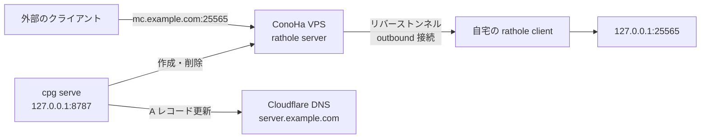

<!--
status: draft（未公開）
title: ConoHa VPSを待機0台にする — 時間課金の「消し忘れ」を構造で防ぐ
target: Qiita / ConoHa Advent Calendar 2026（https://qiita.com/advent-calendar/2026/conoha）
tags: ConoHa, VPS, nftables, rathole, OpenStack
source: sas-news/conoha-port-gate（非公開リポジトリ）の実装に基づく。
  技術的主張の根拠: src/conoha_port_gate/sessions.py（リーパー・リコンシル）、
  conoha.py（削除確認・404冪等）、cloudinit.py（nft/ufw分岐・トランスポート）、
  rules.py（SG生成）、cloudflare.py（Aレコード1本）。
公開時のやること:
  - 冒頭に「ConoHa Advent Calendar 2026 n日目です」を追記
  - リポジトリを public にするなら末尾にURLを追記
  - 公開後、このファイルを qiita/<記事ID>.md に移動しURLを記録、STOCK.md を published に更新
-->

# ConoHa VPSを待機0台にする — 時間課金の「消し忘れ」を構造で防ぐ

## はじめに：時間課金の本当の罠

ConoHa VPS は時間課金だ。1 ヶ月に満たない利用なら時間単位の料金が適用され、**月額を超える請求は発生しない**。この 2 点は[公式FAQ](https://support.conoha.jp/common/faq/payment-q/billing-q/)に明記されている。

一方で、同じ FAQ にはこうもある。

> ConoHa VPS・ConoHa for Windows Server・ConoHa for GAMEについて、停止（シャットダウン）いただいた場合でも料金が変動することはございません。サーバーの稼動、停止の状態にかかわらず、ご契約数で料金が発生いたします。

つまり課金を止めるスイッチは「停止」ではなく **「削除」しかない**。1 時間に満たない利用は 1 時間分の料金が発生する、というのも同じページにある。

この 2 つの性質は、読み替えるとこうなる。

- **待機中の VPS が 0 台なら、待機費は構造的に 0 円**
- ただし「自分で忘れずに削除する」運用は、必ずどこかで失敗する

本記事の主題は後者、**「消し忘れ」を運用ではなく構造で防ぐ設計**である。API で VPS を作る話自体は、公式が [MCP サーバー](https://vps.conoha.jp/)で AI エージェントに VPS 作成・設定変更を代行させる時代なので、今や珍しくない。だから本稿では「作る」の詳細には紙幅を割かず、「**必ず消える**」をどう保証するかに絞って書く。

題材は、自宅サーバーのサービスを必要なときだけ ConoHa VPS 経由で公開する小さな制御ツール（`cpg`）だ。

- 使うとき: ConoHa API で VPS を 1 台作り、rathole のリバーストンネルで自宅サービスへ転送する
- 終わるとき: TTL または明示的な close で VPS・ボリューム・セキュリティグループを削除する
- 待機中: **VPS は存在しない**。DNS は閉塞用 IP を返す

先に断っておくと、これは DDoS 対策ではない。自宅のグローバル IP を出さないためのリレー構成で、攻撃を受ける前提の防御は別のレイヤーの話である。

## できあいの形

```console
$ cpg up mc --ttl 120 --wait
id       : 5f3c1a2b
profile  : mc
state    : active (done 100%)
host     : mc.example.com
ip       : 203.0.113.10
expires  : 2026-12-14T20:00:00+00:00 (残り 120 分)
cost     : 約 2.6 円

$ nc -vz mc.example.com 25565
Connection to mc.example.com 25565 port [tcp/*] succeeded!

$ cpg down
closing: 5f3c1a2b (mc)
```

待機中は ConoHa 上に何も残らない。`server.example.com` は `192.0.2.1`（TEST-NET-1）を返して接続を受けない。

1 セッション = VPS 1 台 + ブートボリューム 1 本 + セキュリティグループ 1 個 + Cloudflare の A レコード 1 本の書き換え。VPS 1 台のなかに複数の公開ポートを持たせられる。

自宅側は outbound だけで済む。ルーターのポート開放は不要で、CGNAT 環境でも動く。なお「常時 VPS を立てておく」案と比べているのは金額だけで、待機費 0 円 vs 月額数百円、である。

## 構成



制御プロセス（`cpg serve`）は自宅の常時起動サーバーで `127.0.0.1` にのみバインドする。VPS 側に入れるのは rathole だけ。SSH の穴は原則開けない。

## 「消し忘れ」を構造で防ぐ 5 つの設計

ここが本題だ。時間課金 VPS を「使い捨て」として回す条件は、**削除を人間の仕事にしない**ことである。

### 1. 削除は「消えたことを確認するまで」

削除 API が 200 を返した直後、実はまだリソースが残っていることがある。だから削除は必ず **DELETE → 一覧ポーリングで 404 になるまで待つ** セットにする。VPS・ボリュームとも、消えたことが確認できるまで次に進まない。

削除系の API 呼び出しは **404 を成功として扱う**。これで close は冪等になり、二回流しても何も壊れない。ロールバック（作成中に失敗したら逆向きに片付ける）も同じ経路を通るので、成功・失敗・中断のすべての経路が同じ削除コードを通ることになる。

### 2. 有効期限をリソース側に刻む

セッションの有効期限は制御側の SQLite にだけ置いてはいけない。制御プロセスが死んだり DB が吹き飛んだりした瞬間、「いつ消すべきか」を誰も知らなくなる。

そこで VPS 作成時の **ネームタグに期限を刻む**：

```
pg-<セッションID 8 桁>-<期限の unixtime>
```

ボリュームは `pg-<sid>-vol`、セキュリティグループは `pg-<sid>-sg`。ConoHa のサーバー一覧を見るだけで、孤立したリソースが「本来いつまでの存在か」を自己記述している。制御プレーンが記憶を失っても、リソース自身が持っている。

### 3. リーパーを 2 段で回す

制御プロセス内で 2 種類の掃除ループを回す。

- **30 秒ごと**: 期限切れセッションを close する（TTL の実行部分）
- **5 分ごと**: `pg-` タグ付きかつ期限切れかつ管理下にない **孤児** を掃除する

孤児掃除の判定はすべて上のタグ命名で行う。サーバーはネームタグの期限、ボリュームと SG は `pg-` 名 + 未使用 + 作成後 15 分経過。命名規約とリーパーが対になっているのがポイントで、**作成側がタグを付ける限り、回収側は漏れなく対象を特定できる**。

### 4. 再起動時のリコンシリエーション

制御プロセスの再起動時（lifespan 起動時）に、前回のプロセスが残した中途半端な状態を片付ける。

- `provisioning` / `queued` だったセッション → `failed` にして即破棄
- `closing` だったセッション → 削除処理を再開

「作成中に落ちた」を放置すると、VPS が完成したのに誰も管理していない状態ができる。これを持ち越さないのが、障害時に課金が積み上がるのを防ぐ要になる。

### 5. 最後の防壁は月額上限

ここまでの安全装置が全部同時に死んでも、時間課金には月額上限がある（前出の FAQ：「月額を超えるご請求は発生しません」）。512MB プランなら損失の最大値は数百円/月で頭打ちだ。

**「最悪でもこの金額」という上限を、保険料として設計に組み込む**。時間課金の月額上限は単なる料金の話ではなく、自動化システムの最終フェイルセーフとして使える、というのが本稿で一番言いたいことのひとつである。

### 補足：冪等な受け口

外部プロセスから呼ぶ HTTP API（`127.0.0.1` のみ）は `Idempotency-Key` を受け付ける。同じキーには同じセッションを返し、同一プロファイルが active なら既存を返す。同時上限（`max_sessions`、デフォルト 1）を超える要求は 409 で拒否。Bot から叩いても二重で VPS が生えない。

## VPS の中身は cloud-init 1 発

ConoHa VPS 3.0 の API は OpenStack 流なので、作成は次の形になる。

1. イメージからブートボリュームを作成
2. `block_device_mapping_v2` でそのボリュームを指定してサーバーを作成（このとき `user_data` を渡す）

API ユーザーまわりの前提知識（VPS を 1 台契約していないとコントロールパネルに API メニューが出ない、API ユーザーは 1 アカウント 1 つで権限は変更不可、パスワードは ConoHa アカウントのものと別）は[公式ドキュメント](https://doc.conoha.jp/reference/api-vps3/)に譲る。

OS は 512MB プランでは Ubuntu が選べないため Debian 13 を使う（フレーバー `g2l-t-c1m512`、イメージ `debian-13.5`）。cloud-init（`user_data`）が VPS 側のすべてを仕上げる：

- rathole の `server.toml` を 0600 で配置（トークンと鍵を含むのでパーミッション重要）
- systemd unit を生成（`Restart=always` に加え `NoNewPrivileges` / `ProtectSystem=strict`）
- rathole バイナリをダウンロードし sha256 検証 → **`python3 -m zipfile -e` で展開**（`unzip` に依存しない、軽い小技）
- OS ファイアウォールの設定（次節）

`ACTIVE` まで 60〜120 秒。cloud-init の成否は VPS に入って確認する手段を持たないので、最終確認は外部からの実接続で行う。

なお ConoHa には **同一フレーバーの契約数上限** がある。消し残した VPS があると次の作成が 400 で失敗する。これが「待機 0 台」をやる実用的な動機でもあった。

## SG を開けても届かない — Debian 13 テンプレートの nftables

最初のセッションで最初にハマったのがこれである。セキュリティグループ（SG）で 25565/tcp を `0.0.0.0/0` に許可したのに、外部からは timeout する。

OS の中を見ると原因がわかった。**ConoHa の Debian 13 テンプレートは、nftables が input チェーン `policy drop`・22 番のみ許可で起動する**：

```console
$ nft list ruleset
table inet filter {
  chain input {
    type filter hook input priority filter; policy drop;
    iif "lo" accept
    ct state established,related accept
    tcp dport 22 accept
  }
}
```

SG はインフラ層、nftables は OS 層。SG で許可しても OS の input が drop ならパケットは届かない。この罠の発見と詳細な説明は [ConoHaのVPSのポートに穴をあけて外部通信できるようにした](https://blog.lycolia.info/0745) が先なので、そちらに譲る。

本稿で付け足すのは、**この 2 層を cloud-init で同時に開ける**部分だ。SG に追加する許可リストを 1 つの設定から機械生成し、OS 側にも同じものを入れる。OS 側は nftables と ufw のどちらが載っているかテンプレートごとに違うので、cloud-init で分岐させる：

```bash
if command -v nft >/dev/null 2>&1 && nft list table inet filter >/dev/null 2>&1; then
  # Debian 系: nftables の input に SG と同じ許可を追加
  nft add rule inet filter input tcp dport 25565 accept
  nft add rule inet filter input ip saddr 203.0.113.10/32 tcp dport 2333 accept
  nft list table inet filter > /etc/nftables.conf
  systemctl enable nftables 2>/dev/null || true
else
  # Ubuntu 系: ufw で同じ意味のものを構築
  ufw --force reset
  ufw default deny incoming
  ufw default allow outgoing
  ufw allow 25565/tcp
  ufw allow from 203.0.113.10/32 to any port 2333 proto tcp
  ufw --force enable
fi
```

（`203.0.113.10` は制御側＝自宅のグローバル IP の例示。実際には起動時に自動検出して埋め込む）

ポイントは 3 つ。

- **「SG を開けたのに繋がらない」を構造で潰す**：許可は 1 つのリストから両層へ機械反映されるので、片方だけ直すという人為ミスが起きない
- **閉じるときは VPS ごと消す**：使い捨てなので OS 側のルール後始末が不要。二重防御が「閉じるのが難しい」から「閉じるのが簡単」に反転する
- **制御ポートは自宅 IP の /32 だけ**：rathole の制御ポート（2333/tcp）は自宅からの接続に限定し、SSH は SG に穴を開けない。全開放（`0.0.0.0/0`）は設定に `public: true` を明示しないとエラーになる運用も効く

## DNS：動かす A レコードは 1 本だけ

外部向けの名前解決は、**動的更新点を 1 つに絞る**。

- `server.example.com`（A、TTL 60、DNS only）：セッション中は VPS の IP、待機中は `192.0.2.1`
- `mc.example.com` などサービス名は `server` への **静的 CNAME**。公開サービスを増やしても、動的管理対象は A レコード 1 本のまま

ここで気づくのは、**振り分けの本質はサブドメインではなくポート**だということ。`mc` も `palworld` も DNS 上は同じ IP を指す別名で、実際の区別は `25565/tcp` と `8211/udp` というポートで行う。SRV レコード対応のプロトコル（Minecraft Java 版など）だけ、`_minecraft._tcp.mc → server.example.com:25565` の SRV でクライアント側のポート指定を省ける。

待機中の閉塞も 1 技である。**レコードを削除して NXDOMAIN にしない**。代わりに `192.0.2.1`（TEST-NET-1、接続できないことが保証されたアドレス）を指させる。ネガティブキャッシュに悩まされず、「閉じた」ことを DNS TTL 60 秒で確実に伝えられる。レコードが 1 本なので、閉塞の取りこぼしも構造的に起きない。

もうひとつ、この方式には **VPS 側に Cloudflare の資格情報を置かない**という副次効果がある。IP は ConoHa の作成 API が返すものなので、VPS 上の DDNS クライアントも不要になる。使い捨て VPS に長生きするシークレットを置かない設計は、削除運用と相性が良い。

## トンネルは rathole

トンネルには [rathole](https://github.com/rathole-org/rathole) を使った。frp / ngrok に比べると日本語情報は少ないが（日本語だと [rathole + Caddy による内網脱出](https://doc.liz6.com/ja/homelab/rathole-tunnel) が詳しい）、次が採用理由である。

- Noise プロトコル（`Noise_NK_25519_ChaChaPoly_BLAKE2s`）で、共有トークンに加えてサーバー公開鍵で認証できる
- UDP の転送に対応する（Minecraft Bedrock の 19132/udp など）
- Rust 製で 512MB VPS でも余裕がある

自宅側の設定（`server.toml` 側は cloud-init が生成する）：

```toml
[client]
remote_addr = "server.example.com:2333"
default_token = "..."

[client.transport]
type = "noise"

[client.transport.noise]
pattern = "Noise_NK_25519_ChaChaPoly_BLAKE2s"
remote_public_key = "..."

[client.services.minecraft]
local_addr = "127.0.0.1:25565"
```

自宅側クライアントは `Restart=always` で常駐させておくだけ。VPS が存在しない間は再接続を繰り返し、セッションが開いて DNS が切り替わった瞬間に繋がる。「開くまで待つ」処理はクライアント側に何も要らない。

## コスト感

- 512MB（Debian 13）で 2 時間のセッション ≈ 数円。週 1 回遊ぶとして月 10 円台、待機中 0 円
- TTL は分単位で設定できるが、**課金の実効単位は 1 時間**（1 時間未満は切り上げ）。5 分だけのために VPS を生やすと割に合わないので、そういう用途には向かない
- 消し忘れが 1 週間続いても、上限は月額で頭打ち（前出の FAQ）

金額そのものは[料金ページ](https://vps.conoha.jp/pricing/)を参照されたい（本稿執筆時点の話である）。

## まとめ：時間課金 VPS は「消す設計」で初めて使いこなせる

- ConoHa の時間課金は **削除でしか課金が止まらない**。ゆえに「作る・使う・消す」を 1 コマンドに閉じ、削除を人間の仕事から外す
- 消し忘れ対策は運用でなく構造で：**削除完了確認・期限のリソース刻み・2 段リーパー・再起動リコンシル・月額上限**
- SG と OS ファイアウォールは cloud-init で同じ許可リストから同時に開ける（Debian 13 テンプレートの nftables がデフォルト drop なので、SG だけ開けても繋がらない）
- DNS は A レコード 1 本 + 静的 CNAME、閉塞はレコード削除ではなくプレースホルダ IP。VPS にシークレットを置かない
- トンネルは rathole（Noise NK、UDP 対応、制御ポートは自宅 IP のみ許可）

同一構成は他社の時間課金 VPS でも組めるが、OpenStack 流の API で SG・ネームタグ・ボリュームを素直に扱える ConoHa は特に組みやすい。「常時動くサーバー」のための課金モデルを、「使うときだけ生えるサーバー」に転用する話だった。
