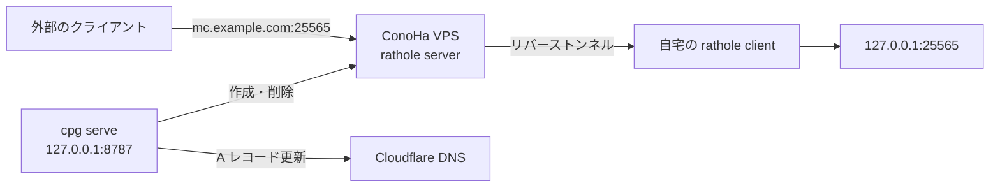

<!--
status: draft（未公開）
title: ConoHa VPSで使い捨てポート転送ツールを作った話
target: Qiita / ConoHa Advent Calendar 2026（https://qiita.com/advent-calendar/2026/conoha）
tags: ConoHa, VPS, rathole, nftables, API
source: sas-news/conoha-port-gate（非公開リポジトリ）の実装に基づく。
  根拠: sessions.py（リーパー・リコンシル）、conoha.py（削除確認・404冪等）、
  cloudinit.py（nft/ufw分岐）、cloudflare.py（Aレコード1本）。
公開時のやること:
  - 冒頭に「ConoHa Advent Calendar 2026 n日目です」を追記
  - リポジトリを public にするなら末尾にURLを追記
  - 公開後、このファイルを qiita/<記事ID>.md に移動しURLを記録、STOCK.md を published に更新
-->

# ConoHa VPSで使い捨てポート転送ツールを作った話

自宅サーバーで Minecraft を動かしているんですが、24時間公開するほどでもない。遊ぶときだけ友達を招きたい。かといって毎回ルーターのポートを開けるのは嫌だし、固定で VPS を借りると使わない時間もずっと課金される。

ConoHa VPS は時間課金で API が生えている。そして **停止しても課金は止まらず、削除でしか止まらない**（[公式FAQ](https://support.conoha.jp/common/faq/payment-q/billing-q/)）。ということは、**使うときだけ VPS を作って、終わったら即削除すれば、待機中は 0 円** ということになる。

なので、ConoHa VPS を「使い捨てのポート転送サーバー」にする小さなツール（`cpg`）を作りました。

## できたもの

```console
$ cpg up mc --ttl 120 --wait
id       : 5f3c1a2b
profile  : mc
state    : active (done 100%)
host     : mc.example.com
ip       : 203.0.113.10
expires  : 2026-12-14T20:00:00+00:00 (残り 120 分)
cost     : 約 2.6 円

$ nc -vz mc.example.com 25565
Connection to mc.example.com 25565 port [tcp/*] succeeded!

$ cpg down
closing: 5f3c1a2b (mc)
```

1 セッション = VPS 1 台 + ブートボリューム + セキュリティグループ + Cloudflare の A レコード 1 本の書き換え。1 台の中に複数の公開ポートを持てます。待機中は VPS が存在しないので、`mc.example.com` は接続できない IP（`192.0.2.1`）を返します。

先に言っておくと、これは DDoS 対策ではなく自宅のグローバル IP を出さないための構成です。

## 構成



- `cpg up` が ConoHa API でセキュリティグループ・ボリューム・VPS を作る（60〜120秒）
- VPS の中は cloud-init が全部用意する（rathole サーバー + ファイアウォール）
- 自宅の rathole クライアントは常駐させておくだけ。VPS ができると逆方向から繋ぎに行き、VPS の公開ポートを自宅の `127.0.0.1:25565` へ転送する
- 自宅からは outbound だけなので、ルーターのポート開放は不要（CGNAT でも動く）
- 終わったら `cpg down` で VPS・ボリューム・セキュリティグループを削除。TTL を過ぎたら勝手に削除される

## 一番ハマった：Debian 13 の nftables

最初のセッションで、セキュリティグループ（SG）で 25565/tcp を `0.0.0.0/0` に許可したのに外部から繋がらない、という事態に。

VPS の中で見ると原因がわかりました。**ConoHa の Debian 13 テンプレートは、OS 内の nftables が input チェーン `policy drop`・22 番だけ許可で起動する**：

```console
$ nft list ruleset
table inet filter {
  chain input {
    type filter hook input priority filter; policy drop;
    iif "lo" accept
    ct state established,related accept
    tcp dport 22 accept
  }
}
```

SG はインフラ層、nftables は OS 層。SG で開けても OS が drop してたら届きません。この落とし穴自体は先人の記事（[ConoHaのVPSのポートに穴をあけて外部通信できるようにした](https://blog.lycolia.info/0745)）が詳しいので、そちらを見てください。

このツールでは、SG に追加したポートと同じものを cloud-init で OS 側にも開けるようにしました。nftables があれば nft、なければ ufw に分岐します。

```bash
if command -v nft >/dev/null 2>&1 && nft list table inet filter >/dev/null 2>&1; then
  nft add rule inet filter input tcp dport 25565 accept
  nft add rule inet filter input ip saddr 203.0.113.10/32 tcp dport 2333 accept
  nft list table inet filter > /etc/nftables.conf
  systemctl enable nftables 2>/dev/null || true
else
  ufw --force reset
  ufw default deny incoming
  ufw default allow outgoing
  ufw logging on
  ufw allow 25565/tcp
  ufw allow from 203.0.113.10/32 to any port 2333 proto tcp
  ufw --force enable
fi
```

（`203.0.113.10` は自宅のグローバル IP。起動時に自動検出して埋め込む）

許可リストは 1 つの設定から SG と OS に同じものを入れるので、「SG 開けたのに繋がらない」が構造的に起きなくなります。閉じるときは VPS ごと消すので OS 側の後始末も不要。rathole の制御ポート（2333/tcp）は自宅 IP の /32 だけ許可、SSH は開けません。`0.0.0.0/0` を開ける設定には `public: true` の明示を必須にしていて、うっかり全開放も防いでいます。

## 消し忘れ対策

時間課金で一番怖いのはここ。停止しても課金は続くので、VPS を残したまま寝ると朝まで課金です。なので「消す」までをツールの仕事にしています。

- **削除は 404 になるまでポーリングして確認**。DELETE が 200 を返した時点ではまだ消えていないことがある。削除系 API の 404 は成功扱いなので、close は冪等で何回流れても安全
- **VPS のネームタグに期限を刻む**（`pg-<セッションID>-<期限のunixtime>`）。制御側の DB が吹き飛んでも、ConoHa 側に残ったリソース自身が「いつまでの存在か」を持っている
- **リーパーが 30 秒ごとに期限切れセッションを close**、5 分ごとに `pg-` タグ付きの管理外リソース（孤児）を掃除
- **制御プロセス再起動時には、作成途中だったセッションを failed にして即回収**。中途半端な状態を持ち越さない
- 全部の安全装置が死んでも、時間課金には月額上限があるので損失は頭打ち

TTL は分単位で指定できるけど、**課金は 1 時間切り上げ**なので、5 分だけのために VPS を生やすと逆に損です。

## DNS は A レコード 1 本だけ

動的に更新するのは `server.example.com` の A レコード（TTL 60）1 本だけ。セッション中は VPS の IP、待機中は `192.0.2.1` を指します。`mc` や `palworld` は `server` への静的 CNAME なので、サービスを増やしても管理点は増えません。

振り分けはサブドメインじゃなくてポートが本質で、`mc` も `palworld` も同じ IP の別名です。Minecraft みたいに SRV が使えるプロトコルだけ SRV でポート指定を省略できます。

閉じるときにレコードを削って NXDOMAIN にしないのは、ネガティブキャッシュに悩まされたくないから。プレースホルダ IP を返せば「閉じた」ことが TTL 60 秒で確実に伝わります。

この方式だと VPS 側に Cloudflare のトークンを置かずに済むのも嬉しいところです。IP は ConoHa の作成 API が返すので、VPS 上で DDNS クライアントを動かす必要がない。

## トンネルは rathole

[rathole](https://github.com/rathole-org/rathole) を使いました。frp / ngrok より日本語情報は少ないですが（日本語だと[このガイド](https://doc.liz6.com/ja/homelab/rathole-tunnel)が詳しい）、Noise プロトコルでトークン＋サーバー公開鍵の認証ができて、UDP も通る（Bedrock の 19132/udp とか）ので、この用途にはちょうど良かったです。

自宅側の設定。サーバー側は cloud-init が生成します。

```toml
[client]
remote_addr = "server.example.com:2333"
default_token = "..."

[client.transport]
type = "noise"

[client.transport.noise]
pattern = "Noise_NK_25519_ChaChaPoly_BLAKE2s"
remote_public_key = "..."

[client.services.minecraft]
local_addr = "127.0.0.1:25565"
```

クライアントは `Restart=always` で常駐。VPS がいない間は再接続を繰り返すだけなので、セッションを開けた瞬間に繋がります。

## 料金

512MB（Debian 13、1.3 円/h くらい）で 2 時間遊ぶと数円。週 1 回なら月 10 円ちょっと、待機中 0 円。常時借りるよりだいぶ安いです（単価は[料金ページ](https://vps.conoha.jp/pricing/)参照）。

## まとめ

- ConoHa VPS を「使うときだけ生えて、終わったら消える」ポート転送サーバーにした。待機中 0 円
- ConoHa は停止で課金が止まらないので、削除まで全部自動化。TTL・リーパー・期限刻みタグで消し忘れに保険をかけ、最悪でも月額上限で頭打ち
- Debian 13 テンプレートは OS 内 nftables が input drop なので、SG と同じポートを cloud-init で OS 側にも開ける
- DNS は A レコード 1 本を切り替えるだけ。閉じたらプレースホルダ IP に戻す
- トンネルは rathole（Noise 認証・UDP 対応・制御ポートは自宅 IP のみ許可）

時間課金って「常時使う人向けの従量制」だと思ってたけど、「使い捨てサーバー」と組み合わせると待機費ゼロの公開環境になって面白い、という話でした。
